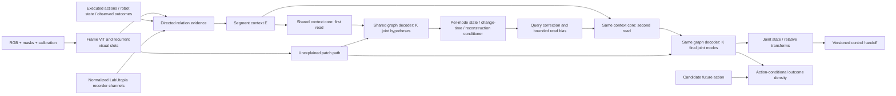

# Architecture and tensor contract

`B` batches independent system prefixes. `T` ordered observed frames. `C` cameras.
`S` visual slot capacity (32 full / 4 smoke), with two extra FK anchors. `E` is all
directed non-self pairs `(S+2)(S+1)`. `L` is observed segments plus a null/prior token.
`K` global scene modes (8 full / 3 smoke), `D` model width (256 full / 32 smoke).

| Boundary | Tensor and semantics |
|---|---|
| Images | `[B,T,C,3,H,W]`, float RGB [0,1], explicit camera/pixel masks |
| Time | exposure, arrival `[B,T]`; every valid observation ≤ query cutoff |
| Execution | `[B,T,A]` executed actions, `[B,T,R]` measured robot response |
| Task | `[B,G]` configured goal information, no perturbation answers |
| Calibration | `[B,T,C,25]`: K 3×3, camera-to-base 4×4 |
| Results | `[B,T,O]` observed results and per-field missing masks |
| Slots | `[B,T,S,D]`, soft patch masks, existence and association distributions |
| Context | `[B,E,L,D]`, per-relation instance aggregation, source deduplication |
| First/final state | means `[B,K,S,6]`, diagonal `[B,K,6S]`, factor `[B,K,6S,r]` |
| Read condition | query correction `[B,K,E,D]`, bias `[B,K,E,L]` |
| Change times | `[B,K,E,bins+2]`: no-event, before-window, window intervals |
| Prediction | mixture over K scene modes × M joint continuous state samples |

The context core never allows queries to write into context. Multiple mode queries
do not attend one another. Cross-edge coupling occurs in a shared graph decoder.
The two rounds call the **same Python module instances**, including the graph decoder.
There are not K independent networks or K×K final mixtures.

The conditioner reads both graph latent states and explicit first-round pose, time
distribution and mode probability. It reconstructs historical relation features under
each hypothesis and executed actions. These residuals are **within-prefix
reconstruction consistency**, not independent causal forecast errors. Future-output
forecasting is a separate query and loss. Bias is bounded by config, applied only to
query→evidence logits, and never applied to the raw unexplained-patch path.

Current inputs are all causal observations; context attention may be bidirectional
inside that arrived prefix. The visual slot recurrence is chronological. Latest images
already in context have one source ID and cannot be appended twice. Missing outcomes
are zeroed and accompanied by masks; they are never imputed from a privileged target.

## LabUtopia recorder path

The LabUtopia importer preserves the native JSON source under `archive__*` fields and
constructs a bounded `recorder__*` view. The recorder encoder turns body, joint,
contact, phase, and optional trace channels into per-frame summary and token streams.
The summary informs the relation nodes before context construction, and relation
queries can attend to the recorder tokens. Raw archive bytes and the field manifest
are provenance data; they are never read as model evidence.

The projection keeps the first and last motion frames and every phase boundary within
`model.max_frames`, then fills remaining slots deterministically. The optional 480 Hz
pose trace is sampled to `model.recorder_trace_frames`. This keeps model tensors bounded
while retaining the complete raw JSON archive for later reprojection.

`deployable` masks simulator body transforms, contact geometry, high-rate trace, and
scripted phase from recorder evidence while retaining measured joint state and command
channels. Normalized oracle positions, contact points, normals, and forces use the
initial robot-base frame; source JSON retains world-coordinate values. The
`recorder_oracle` policy exposes those structured simulator channels for an explicit
oracle or ablation run. Both policies keep the raw source and targets in the dataset;
the target pose and success label do not enter `EvidenceBatch`.

The current importer supplies no acquired RGB or camera calibration. It maps applied
joint targets to the nine-value action field and measured joint positions/velocities to
the 18-value robot field; observed outcomes and robot responses remain invalid or zero.
It is a
file adapter for recorder wiring and provenance retention. A live sensor or robot
integration still needs to provide causal camera data, calibrated frames, action and
response timing, identity supervision, and physical completion checks.

## Density and units

A single categorical mode selects the **whole scene**. Conditional covariance is
`diag(v)+UUᵀ` across every visual node's six coordinates. State NLL marginalizes
unlabeled dimensions by slicing the covariance, then performs one scene-level logsumexp.
It does not mix each node independently or train every component toward the same target.

This first implementation scores a fixed local xyz+rotation-vector coordinate chart,
scaled by training configuration (meters / radians). It does **not** claim a normalized
global SE(3) Haar density or a right-tangent covariance. Principal rotation vectors
have a branch boundary; datasets must keep a consistent local chart or explicitly
enumerate valid symmetry representatives. Metric transformations are derived only
after undoing fixed scaling. Relative poses share nodes, hence have algebraic loop
consistency. Identity correctness remains a separate empirical question.

Object matching uses whole-prefix visible masks for training only. The online model
never receives the Hungarian assignment. Explicit symmetry alternatives are summed
when scoring; duplicates are rejected. Soft slot association is not a certified
persistent identity mapping. Unknown identity/scale/calibration prevents automatic
execution; exported model beliefs are uncalibrated until separately evaluated.

## Extensions

Implement new record producers using the typed sensor/target boundary. Add priors in
`data/`; keep split groups at the mechanism/object/session level before prefix sampling.
Extend task/action dimensions via configuration. Add a new state family by defining
its probabilistic head, normalization, targets and scorer together. Merely adding a
fault label is not needed to add a new entity combination. Sensor dimensions, type
semantics and checkpoint configuration are versioned and checked at load time.
